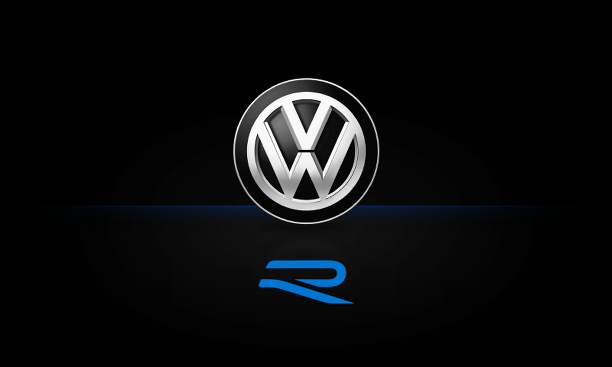

# VW R Logo — MST2 Technisat ZR/PQ 480T Startanim

Custom 800×480 boot animation for **MIB2 STD Technisat / PREH** units.



**Tested on Technisat ZR/PQ 480T** · SW 0480-2 · HW H30

[🇹🇷 Türkçe](#türkçe) · [🇩🇪 Deutsch](#deutsch) · [🇬🇧 English](#english) · [🇷🇺 Русский](#русский)

---

## Türkçe

### Nedir?

Bu depo, MIB2 STD **Technisat / PREH** üniteler için 800×480 çözünürlüklü özel bir açılış animasyonu içerir.

- **VW logosu değiştirilmez.**
- **R logosu** yeni tasarımla değiştirilir ve animasyon boyunca **yukarıdan aşağıya maviye** döner: **%0 → %20 → %40 → %60 → %80 → %100**.
- R logosu tam olarak **VW logosunun altında** ve yatay merkezdedir (x = 400).
- R bölgesindeki **siyah kutu** ve **“WELCOME TO VOLKSWAGEN”** yazısı temizlenmiştir.
- Orijinal **“Sound by DYNAUDIO”** bitişi korunur.

> **Technisat ZR/PQ 480T üzerinde test edilmiştir.** (SW 0480-2, HW H30)

### Teknik bilgiler

| Alan | Değer |
|---|---|
| Dosya | `startup_x.boot` |
| Boyut | 580.490 bayt |
| SHA-256 | `d72457413b45744a2f474f5d8e60f92e0d1f5b71fecd9a54c0c85cc2e7a0734d` |
| Format | SCRT v101 + MIFA |
| animIndex | 9 |
| Script kaydı | 119 |
| Görsel sayısı | 58 |
| Tuval | 800×480 |
| Piksel formatı | UYVY 4:2:2, zlib |
| Test ünitesi | Technisat ZR/PQ 480T (SW 0480-2, HW H30) |

### Dosya adı hakkında

Dosya `startup_x.boot` olarak gelir. Ünitede kullanmak için cihazın skin/animasyon numarasına göre `startup_N.boot` olarak yeniden adlandırın.

Bu dosyanın başlığındaki **animIndex = 9** değerindedir; en güvenli kurulum **`startup_9.boot`** adıyladır. Farklı bir `N` için hem dosya adını hem de başlıktaki `animIndex` alanını **MST2 Startanim Boot Tool** ile güncelleyin.

### Kurulum

> Önce mevcut dosyanın yedeğini alın.

```sh
mount -t qnx6 -o remount,rw /dev/hd0t177 /
cp /tsd/etc/startanim/startup_9.boot /tsd/etc/startanim/startup_9.boot.bak
# startup_x.boot dosyasını /tsd/etc/startanim/startup_9.boot olarak kopyalayın
sync
mount -t qnx6 -o remount,ro /dev/hd0t177 /
shutdown -S reboot
```

Alternatif olarak SD karttaki `startanim` klasörü ile ESD `copy_startanim.sh` kullanılabilir.

### Uyumluluk ve uyarı

- Yalnızca **MST2 / MIB2 STD Technisat-PREH 800×480 (SCRT)** üniteler için tasarlanmıştır.
- Yalnızca **Technisat ZR/PQ 480T** üzerinde test edilmiştir; başka ünitelerde davranış farklı olabilir.
- Kurulumdan önce mutlaka yedek alın. Yanlış dosya veya uyumsuz yazılım üniteyi açılmaz hale getirebilir.
- Bu proje **Volkswagen AG ile bağlantılı değildir**; resmî bir ürün değildir. VW ve R logoları Volkswagen AG'nin ticari markalarıdır.

### Sürüm

- **v3.1** — 2026-11-10: R çevresindeki hayalet/kutu temizlendi, R tam merkezlendi, tüm R karelerinin zemini son temiz tam ekran kareden alındı.
- **v3** — Yeni R logosu, yukarıdan aşağıya mavi dolgu, temiz zemin.
- **v1/v2** — İlk R logo çalışmaları.

### Emeği geçenler

Tasarım ve test: **VAO** ([vagcomantalyaofficial](https://github.com/vagcomantalyaofficial))  
Üretim aracı: **MST2 Startanim Boot Tool**

---

## Deutsch

### Was ist das?

Dieses Repository enthält eine individuelle 800×480-Startanimation für **MIB2-STD-Technisat/PREH-Geräte**.

- Das **VW-Logo bleibt unverändert.**
- Das **R-Logo** wird durch ein neues Design ersetzt und färbt sich während der Animation **von oben nach unten blau**: **0 % → 20 % → 40 % → 60 % → 80 % → 100 %**.
- Das R-Logo sitzt exakt **unter dem VW-Logo** und horizontal zentriert (x = 400).
- Der **schwarze Kasten** und der Schriftzug **„WELCOME TO VOLKSWAGEN“** im R-Bereich wurden entfernt.
- Das originale **„Sound by DYNAUDIO“**-Ende bleibt erhalten.

> **Getestet auf Technisat ZR/PQ 480T.** (SW 0480-2, HW H30)

### Technische Daten

| Feld | Wert |
|---|---|
| Datei | `startup_x.boot` |
| Größe | 580.490 Bytes |
| SHA-256 | `d72457413b45744a2f474f5d8e60f92e0d1f5b71fecd9a54c0c85cc2e7a0734d` |
| Format | SCRT v101 + MIFA |
| animIndex | 9 |
| Script-Einträge | 119 |
| Bilder | 58 |
| Auflösung | 800×480 |
| Pixelformat | UYVY 4:2:2, zlib |
| Testgerät | Technisat ZR/PQ 480T (SW 0480-2, HW H30) |

### Dateiname

Die Datei heißt `startup_x.boot`. Für die Installation auf dem Gerät benennen Sie sie entsprechend der Skin-/Animationsnummer in `startup_N.boot` um.

Der Header dieser Datei hat **animIndex = 9**; die sicherste Installation ist daher **`startup_9.boot`**. Für ein anderes `N` müssen sowohl der Dateiname als auch das `animIndex`-Feld im Header mit dem **MST2 Startanim Boot Tool** angepasst werden.

### Installation

> Erstellen Sie zuerst eine Sicherung der vorhandenen Datei.

```sh
mount -t qnx6 -o remount,rw /dev/hd0t177 /
cp /tsd/etc/startanim/startup_9.boot /tsd/etc/startanim/startup_9.boot.bak
# startup_x.boot nach /tsd/etc/startanim/startup_9.boot kopieren
sync
mount -t qnx6 -o remount,ro /dev/hd0t177 /
shutdown -S reboot
```

Alternativ kann der ESD-Befehl `copy_startanim.sh` mit dem `startanim`-Ordner auf der SD-Karte verwendet werden.

### Kompatibilität und Hinweis

- Nur für **MST2 / MIB2 STD Technisat-PREH 800×480 (SCRT)** geeignet.
- Nur auf **Technisat ZR/PQ 480T** getestet; andere Geräte können abweichen.
- Vor der Installation unbedingt sichern. Eine falsche Datei oder inkompatible Software kann das Gerät unbrauchbar machen.
- Dieses Projekt steht **in keiner Verbindung zur Volkswagen AG** und ist kein offizielles Produkt. VW- und R-Logos sind Marken der Volkswagen AG.

### Version

- **v3.1** — 10.11.2026: Geister-/Kastenbildung um das R entfernt, R zentriert, Hintergründe aller R-Frames vom letzten sauberen Vollbild übernommen.
- **v3** — Neues R-Logo, Blau-Füllung von oben nach unten, sauberer Hintergrund.
- **v1/v2** — Erste R-Logo-Versionen.

### Credits

Design und Test: **VAO** ([vagcomantalyaofficial](https://github.com/vagcomantalyaofficial))  
Erstellt mit dem **MST2 Startanim Boot Tool**.

---

## English

### What is this?

This repository contains a custom 800×480 boot animation for **MIB2 STD Technisat / PREH** units.

- The **VW logo is unchanged.**
- The **R logo** is replaced with a new design and turns **blue from top to bottom** during the animation: **0% → 20% → 40% → 60% → 80% → 100%**.
- The R logo is centered exactly **below the VW logo** (x = 400).
- The **black box** and the **“WELCOME TO VOLKSWAGEN”** text in the R area were removed.
- The original **“Sound by DYNAUDIO”** ending is preserved.

> **Tested on Technisat ZR/PQ 480T.** (SW 0480-2, HW H30)

### Technical details

| Field | Value |
|---|---|
| File | `startup_x.boot` |
| Size | 580,490 bytes |
| SHA-256 | `d72457413b45744a2f474f5d8e60f92e0d1f5b71fecd9a54c0c85cc2e7a0734d` |
| Format | SCRT v101 + MIFA |
| animIndex | 9 |
| Script records | 119 |
| Images | 58 |
| Canvas | 800×480 |
| Pixel format | UYVY 4:2:2, zlib |
| Tested unit | Technisat ZR/PQ 480T (SW 0480-2, HW H30) |

### About the file name

The file is named `startup_x.boot`. On the unit, rename it to `startup_N.boot` matching the skin/animation number.

The header of this file has **animIndex = 9**, so the safest installation is as **`startup_9.boot`**. For a different `N`, update both the file name and the header `animIndex` field with the **MST2 Startanim Boot Tool**.

### Installation

> Back up the existing file first.

```sh
mount -t qnx6 -o remount,rw /dev/hd0t177 /
cp /tsd/etc/startanim/startup_9.boot /tsd/etc/startanim/startup_9.boot.bak
# copy startup_x.boot to /tsd/etc/startanim/startup_9.boot
sync
mount -t qnx6 -o remount,ro /dev/hd0t177 /
shutdown -S reboot
```

Alternatively, use the ESD `copy_startanim.sh` script with the `startanim` folder on an SD card.

### Compatibility and disclaimer

- Designed only for **MST2 / MIB2 STD Technisat-PREH 800×480 (SCRT)** units.
- Tested only on **Technisat ZR/PQ 480T**; other units may behave differently.
- Always back up before installing. A wrong file or incompatible software can make the unit unbootable.
- This project is **not affiliated with Volkswagen AG** and is not an official product. VW and R logos are trademarks of Volkswagen AG.

### Version

- **v3.1** — 2026-11-10: removed the ghost/box around the R, centered the R, all R frames now use the last clean full-screen background.
- **v3** — New R logo, top-to-bottom blue fill, clean background.
- **v1/v2** — Initial R logo versions.

### Credits

Design and testing: **VAO** ([vagcomantalyaofficial](https://github.com/vagcomantalyaofficial))  
Built with the **MST2 Startanim Boot Tool**.

---

## Русский

### Что это?

В этом репозитории находится пользовательская заставка 800×480 для устройств **MIB2 STD Technisat / PREH**.

- **Логотип VW не изменяется.**
- **Логотип R** заменён новым дизайном и во время анимации заполняется **синим цветом сверху вниз**: **0 % → 20 % → 40 % → 60 % → 80 % → 100 %**.
- Логотип R расположен точно **под логотипом VW** и по центру (x = 400).
- **Чёрный прямоугольник** и надпись **«WELCOME TO VOLKSWAGEN»** в области R удалены.
- Оригинальное окончание **«Sound by DYNAUDIO»** сохранено.

> **Протестировано на Technisat ZR/PQ 480T.** (SW 0480-2, HW H30)

### Технические данные

| Параметр | Значение |
|---|---|
| Файл | `startup_x.boot` |
| Размер | 580 490 байт |
| SHA-256 | `d72457413b45744a2f474f5d8e60f92e0d1f5b71fecd9a54c0c85cc2e7a0734d` |
| Формат | SCRT v101 + MIFA |
| animIndex | 9 |
| Записей скрипта | 119 |
| Изображений | 58 |
| Разрешение | 800×480 |
| Формат пикселей | UYVY 4:2:2, zlib |
| Тестовое устройство | Technisat ZR/PQ 480T (SW 0480-2, HW H30) |

### Имя файла

Файл называется `startup_x.boot`. Для установки на устройство переименуйте его в `startup_N.boot` в соответствии с номером скина/анимации.

В заголовке файла указан **animIndex = 9**, поэтому самый безопасный вариант установки — **`startup_9.boot`**. Для другого `N` нужно изменить и имя файла, и поле `animIndex` в заголовке с помощью **MST2 Startanim Boot Tool**.

### Установка

> Сначала сделайте резервную копию существующего файла.

```sh
mount -t qnx6 -o remount,rw /dev/hd0t177 /
cp /tsd/etc/startanim/startup_9.boot /tsd/etc/startanim/startup_9.boot.bak
# скопируйте startup_x.boot в /tsd/etc/startanim/startup_9.boot
sync
mount -t qnx6 -o remount,ro /dev/hd0t177 /
shutdown -S reboot
```

Альтернативно можно использовать ESD-скрипт `copy_startanim.sh` с папкой `startanim` на SD-карте.

### Совместимость и предупреждение

- Только для устройств **MST2 / MIB2 STD Technisat-PREH 800×480 (SCRT)**.
- Протестировано только на **Technisat ZR/PQ 480T**; на других устройствах поведение может отличаться.
- Перед установкой обязательно сделайте резервную копию. Неправильный файл или несовместимое ПО может сделать устройство неработоспособным.
- Проект **не связан с Volkswagen AG** и не является официальным продуктом. Логотипы VW и R являются товарными знаками Volkswagen AG.

### Версия

- **v3.1** — 10.11.2026: удалён «призрак»/рамка вокруг R, R отцентрирован, фон всех кадров R берётся с последнего чистого полноэкранного кадра.
- **v3** — Новый логотип R, синяя заливка сверху вниз, чистый фон.
- **v1/v2** — Первые версии логотипа R.

### Авторы

Дизайн и тестирование: **VAO** ([vagcomantalyaofficial](https://github.com/vagcomantalyaofficial))  
Создано с помощью **MST2 Startanim Boot Tool**.

---

## Repository contents

| File | Description |
|---|---|
| `startup_x.boot` | The boot animation (SCRT/MIFA, 800×480) |
| `preview.png` | Main preview image |
| `README.md` | This document |

## Verify

```sh
sha256sum startup_x.boot
# d72457413b45744a2f474f5d8e60f92e0d1f5b71fecd9a54c0c85cc2e7a0734d
```

---

**Disclaimer:** This is an unofficial personal customization. It is not affiliated with, endorsed by, or sponsored by Volkswagen AG. VW and R are trademarks of Volkswagen AG. Use at your own risk.
